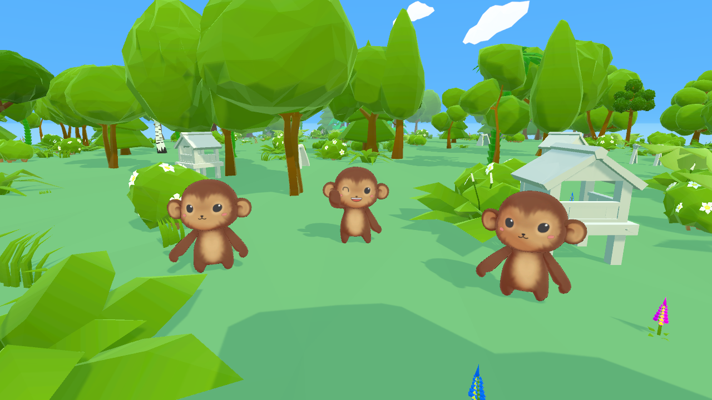

# HighlandLake 三只展示猴子

目标场景：`Assets/Environment Aseets/01_HighlandLake_可玩场景/Scenes/HighlandLake_Backup_2026-11-03.unity`。

资源来自队友 `feat/monkey-animation-library` 分支，提交 `a5479464aef1282eed5c2f8c19f1880684d1daf3`。仅导入 `Assets/MonkeyNPC/` 及对应 meta；未合并或覆盖其他分支文件。

## 场景配置

三只均为 MonkeyNPC Prefab 实例，在 Hierarchy 根目录按名称搜索即可定位。位置是世界坐标，Y 通过 Island_1 碰撞表面的向下射线取得。

| 对象 | 位置 X/Y/Z | 动作 |
|---|---|---|
| Monkey_Idle_01 | -2.5 / 0.1374 / -16 | StandingIdle 循环 |
| Monkey_Idle_02 | 2.5 / 0.1244 / -17 | StandingIdle 循环 |
| Monkey_Wave_01 | 0 / 0.1510 / -14.5 | Hi 循环 |

挥手实例使用 `Assets/MonkeyNPCSceneSetup/MonkeyWaveLoop.controller`，默认状态为 Hi，Motion 为同目录的 Hi_Loop.anim（Loop Time 开启），没有 Hi → StandingIdle 过渡。原始动画与控制器没有改动。

三只猴子的 Collider 都禁用，但组件保留，防止现有射线脚本自动补建碰撞体。这三只不阻挡玩家，也不响应物理射线点击。Root Motion 关闭，动作驱动、表情、手部接触组件及动画库引用均保留。

## 如何修改和调用

- 调位置：选择场景实例，修改 Transform，不要将位置或控制器覆盖 Apply All 到公共 Prefab。
- 恢复挥手一次：给挥手实例换回原始 MonkeyNPC.controller；用 MonkeyNpcAnimator.Wave() 触发。
- 其他动作：获取 Animator 所在物体上的 ADayAtTheZoo.Monkeys.MonkeyNpcAnimator，调用 Stand()、Sit()、ShowHunger()、Feed()、Walk()、Run()、Scratch() 或 Wave()。
- Feed() 使用原有 Eating → Happy → StandingIdle 流程；Walk/Run 仅切换动画，不负责移动。
- 如果以后恢复交互，再启用对应 Collider，并确定固定展示是否需要被玩家动作打断。

## 验证和已知环境限制

在 Unity 6000.3.23f1 中导入、编译并进入 Play 模式。核对所有 Prefab、控制器和动画库 GUID 引用完整；导入的 52 个源文件与下载内容逐字节一致。

本机现有 XR 环境出现 Android SDK 缺失提示和 MetaXR xrGetSystem 初始化错误，普通 Play 曾显示 No cameras rendering。测试期间仅在运行中的场景禁用 XR rig、启用现有桌面玩家并恢复时间推进；退出 Play 后这些临时设置不保存，项目 XR 配置未改。

桌面测试记录：运行时间 22.69188 秒，两只待机状态均保持 StandingIdle；Hi 的 normalizedTime 为 23.67843，已超过 23 个循环；三只位置与初始位置一致，启用的 Collider 数量均为 0，挥手表情材质为 M_Chibi_Emo_08。预览图为测试时的辅助相机视角，不会新增场景相机。

尚未做 XR 头显/手柄真机验收。若普通 Play 仍无相机输出，应检查现有 XR/桌面玩家切换配置；不要通过重复添加猴子解决。

本次没有新增运行时控制脚本；一次性编辑器工具已移出 Assets。修改前场景备份、下载源文件、验证日志及本次场景差异保存在 `work/monkey-scene-backup-20261107/`（被 Git 忽略）。
